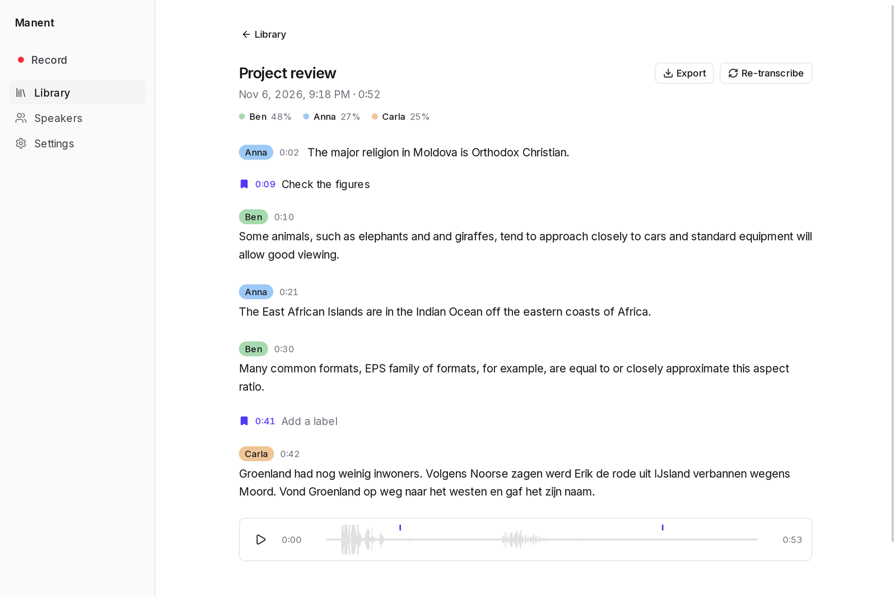
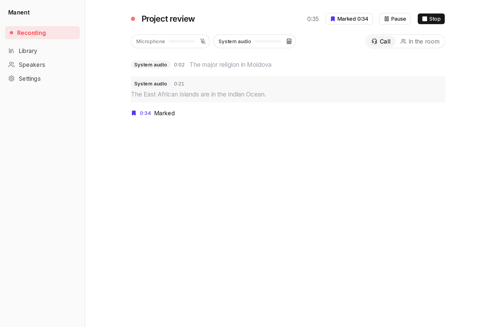
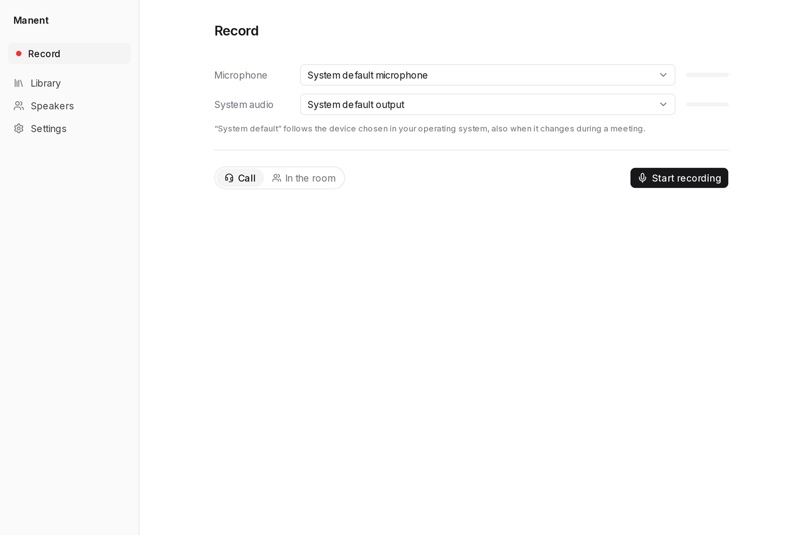
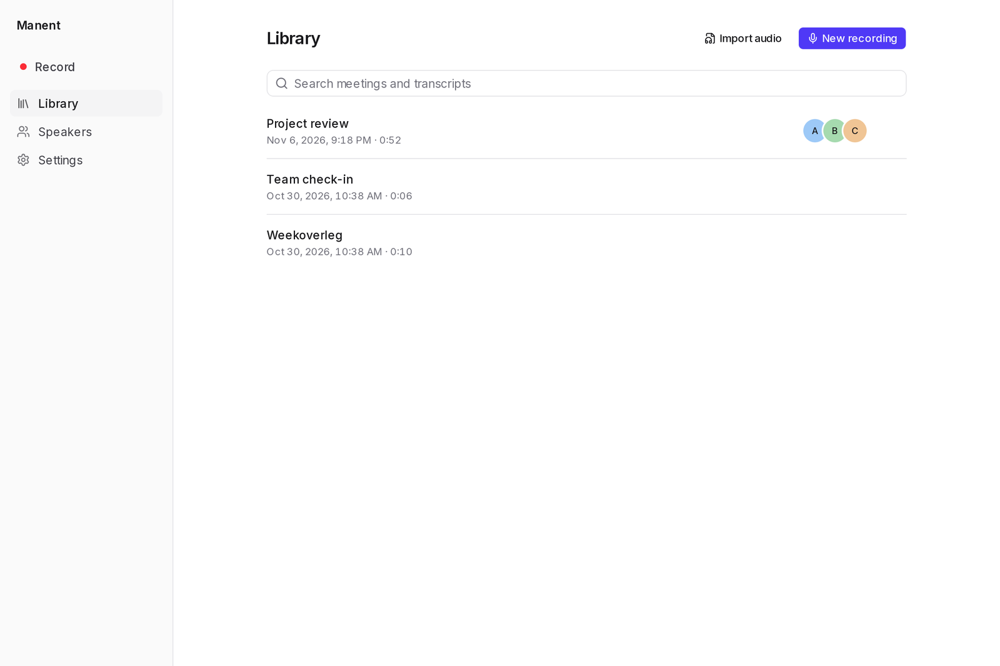
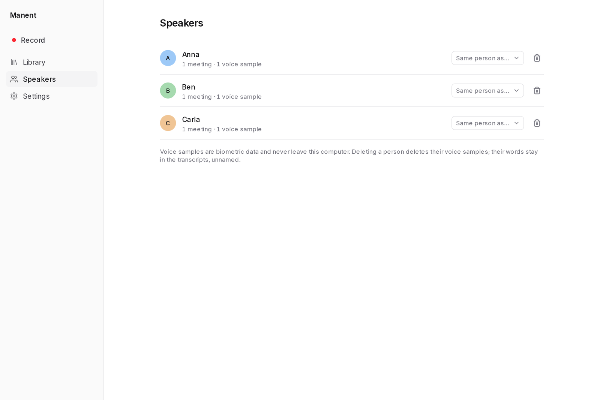
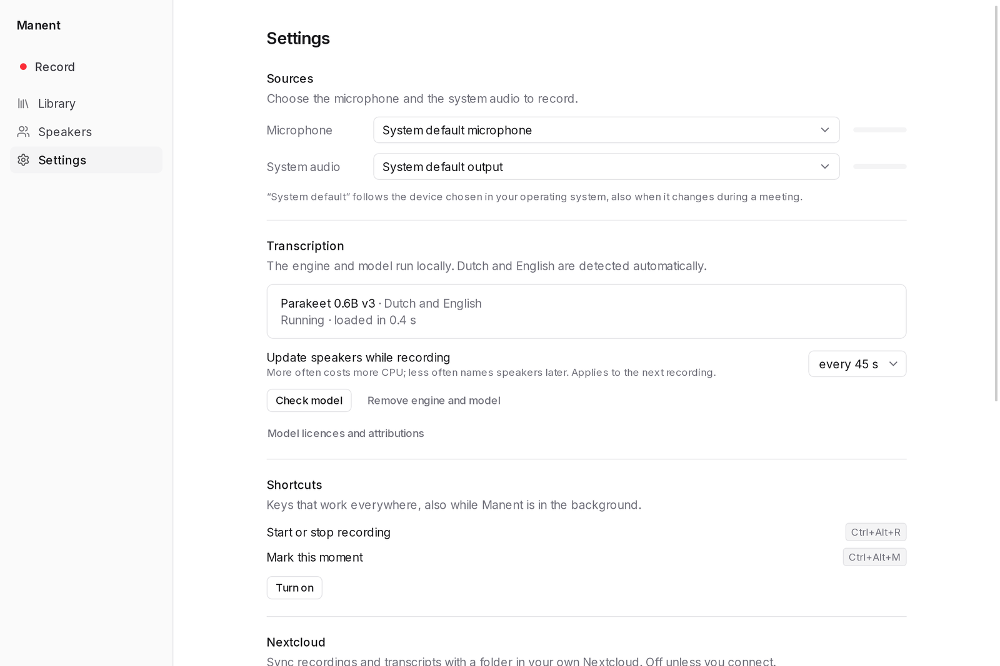

# Manent

A local-first desktop app that records meetings and transcribes them live in Dutch and English, with speaker identification. It runs entirely on your CPU; your audio, transcripts and voice data stay on your computer.

<picture>
  <source media="(prefers-color-scheme: dark)" srcset="docs/screenshots/meeting-dark.png">
  
</picture>

## What it does

**Record**

- Records your microphone and the system audio as separate tracks, so it also captures online calls.
- **Call or in the room:** in a call the microphone is you. In a room, everyone on the microphone is told apart as a separate speaker. Your last choice is remembered.
- Keeps the computer awake while recording. A recording cut off by a crash is recovered at the next start.
- Works from the tray and with global shortcuts, also while the app is in the background: `Ctrl+Alt+R` starts or stops, `Ctrl+Alt+M` marks a moment. The shortcuts are off until you turn them on in Settings.

**Transcribe**

- Live captions while you record, and speaker labels that follow during the meeting.
- A final pass over the whole recording after you stop, for consistent speakers. The player is ready as soon as the audio is mixed, in the background.
- Dutch and English, also when a meeting switches between them. The language is detected automatically.
- Import existing recordings: WAV, MP3, M4A, MP4, MOV, FLAC, Ogg, Opus, MKV and WebM. Drag them onto the window or use Import audio.

**Find it back**

- Name a voice once and Manent recognises that person in later meetings.
- Mark moments while recording, with an optional label. Marks show in the transcript and on the player.
- Click a word to play from there; the transcript follows playback.
- Search all your meetings and transcripts.
- Export to Markdown, plain text, SRT or JSON. Every meeting also gets a `transcript.md` next to its audio, readable without the app.
- Optional sync with a folder in your own Nextcloud.

## Screenshots

### Recording

<picture>
  <source media="(prefers-color-scheme: dark)" srcset="docs/screenshots/live-dark.png">
  
</picture>

### Getting ready

<picture>
  <source media="(prefers-color-scheme: dark)" srcset="docs/screenshots/record-dark.png">
  
</picture>

### Library

<picture>
  <source media="(prefers-color-scheme: dark)" srcset="docs/screenshots/library-dark.png">
  
</picture>

### Known voices

<picture>
  <source media="(prefers-color-scheme: dark)" srcset="docs/screenshots/speakers-dark.png">
  
</picture>

### Settings

<picture>
  <source media="(prefers-color-scheme: dark)" srcset="docs/screenshots/settings-dark.png">
  
</picture>

The speech in these screenshots is read text from [Google FLEURS](https://huggingface.co/datasets/google/fleurs) (CC-BY-4.0), with made-up names.

## Privacy

- Audio, transcripts and voice data are processed and stored on your computer. There are no cloud APIs and no telemetry.
- The only internet traffic is the one-time download of the engine and model, and Nextcloud sync if you connect it.
- Nextcloud sync is off by default and goes only to your own server. It never carries voice data or the database.
- Voice samples are biometric data: they stay on your computer, and deleting a person deletes their samples.

## Status

Manent is developed and tested on Fedora Linux (GNOME on Wayland, PipeWire). macOS and Windows are planned but not available yet. The global shortcuts need a desktop that offers the XDG GlobalShortcuts portal and have been tested on GNOME.

Good to know:

- The first use downloads the engine and model, about 1.1 GB.
- The transcription model runs at about 10x real time on a Ryzen AI 9 HX 370 laptop. Slower CPUs were not measured.
- A recording takes about 400 MB per hour. You can choose to keep only the playback file, about 13 MB per hour, but then you can no longer re-transcribe it.

## Install on Fedora

```sh
sudo dnf config-manager addrepo --from-repofile=https://agenticcraft.github.io/manent/rpm/manent.repo
sudo dnf install manent
```

dnf asks you to trust the key "AgenticCraft Releases", fingerprint `1F7D 3617 A994 9B2D B005 8809 74C2 7C26 B291 9785`. Updates then come with dnf and GNOME Software.

## Build from source

You need Node.js, Rust, CMake and the [Tauri prerequisites](https://tauri.app/start/prerequisites/) for Linux.

```sh
npm install
npm run tauri build
```

This builds the app and an RPM in `src-tauri/target/release/bundle/rpm/`. For a development build and the tests, see [AGENTS.md](AGENTS.md).

## Licence

Manent is licensed under the [GPL-3.0-or-later](LICENSE). The transcription models have their own licences, shown under Settings > Transcription > Model licences and attributions.

By [AgenticCraft](https://agenticcraft.ai).
